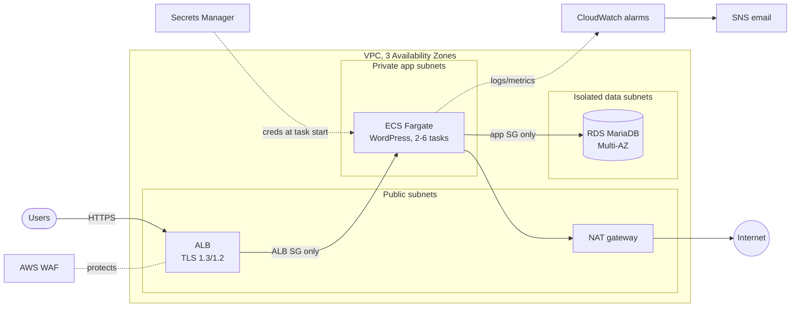

# Secure Three-Tier Platform on AWS

[](https://github.com/Monkmode-tech/aws-secure-three-tier-platform/actions/workflows/terraform-ci.yml)


A production-style AWS web platform built entirely with Terraform modules:
**WordPress on ECS Fargate in private subnets, behind an ALB with AWS WAF and
TLS, backed by a Multi-AZ, KMS-encrypted RDS database whose password never
appears in code.** It autoscales on CPU and traffic, alerts on the golden
signals, and ships with scripts that *prove* the security controls against the
live account.

It began as a course lab (UMGC CLCS 645) that worked but put containers on
public IPs and a database password in plain text. This repo is the hardened
rebuild. **[See the 14 findings and fixes →](docs/hardening-v1-to-v2.md)**

## Architecture



Full diagram, request path, and failure modes: [docs/architecture.md](docs/architecture.md)

## What this demonstrates

| Skill | Where to look |
|-------|---------------|
| Network design: 9-subnet, 3-tier VPC, NAT, route isolation, NACL, flow logs | [`modules/network`](modules/network/main.tf) |
| Least-privilege segmentation (SG-to-SG rules only, DB with no egress) | [`modules/security-groups`](modules/security-groups/main.tf) |
| Edge security: ACM, TLS policy, HTTP to HTTPS, WAF managed rules + rate limiting | [`modules/edge`](modules/edge/main.tf) |
| Secrets management with no secrets in code or task definitions | [`modules/database`](modules/database/main.tf), [`modules/app`](modules/app/main.tf), [ADR 0003](docs/adr/0003-rds-managed-secrets.md) |
| Encryption at rest with a customer-managed KMS key and a scoped key policy | [`modules/kms`](modules/kms/main.tf) |
| Containers: ECS Fargate (Graviton), circuit-breaker rollback, ECS Exec with audit logging | [`modules/app`](modules/app/main.tf) |
| Elasticity: CPU and request-count target tracking, scheduled scaling | [`modules/app`](modules/app/main.tf) |
| Observability: 8 alarms, dashboard, encrypted SNS | [`modules/observability`](modules/observability/main.tf) |
| CI/CD for IaC: fmt, validate, tflint, checkov, shellcheck; OIDC plan on PRs | [`.github/workflows`](.github/workflows) |
| Keyless CI: GitHub OIDC role scoped to one repo, S3-native state locking | [`bootstrap`](bootstrap/main.tf) |
| Verification as code: live security checks, load test, scaling recorder | [`scripts`](scripts) |
| Cost awareness: $50 budget, cost model, documented trade-offs | [docs/cost.md](docs/cost.md), [ADR 0002](docs/adr/0002-single-nat-gateway.md) |
| Architecture decision records | [docs/adr](docs/adr) |

## Results

> Measured on a live deployment; raw outputs are in [`docs/evidence`](docs/evidence).

| Measure | Result |
|---------|--------|
| Security validation (`validate-security.sh`) | _pending first deployment_ |
| Scale-out under a 200-user ramp | _pending_ |
| p95 latency during the ramp | _pending_ |
| Error rate during the ramp | _pending_ |
| RDS Multi-AZ forced failover, site impact | _pending_ |

## Quick start

Prerequisites: AWS CLI v2 with an SSO profile, Terraform >= 1.10, `jq`, and a
domain with a public Route 53 hosted zone (optional; without one the stack runs
in HTTP-only demo mode).

```bash
# 1. One-time account setup: state bucket, GitHub OIDC role, $50 budget
cd bootstrap && terraform init && terraform apply -var="budget_alert_email=you@example.com"

# 2. Configure and deploy (about 20-25 minutes)
cd ../environments/dev
cp backend.hcl.example backend.hcl            # bucket = <state_bucket output>
cp terraform.tfvars.example terraform.tfvars  # domain_name, alert_email
terraform init -backend-config=backend.hcl
terraform apply

# 3. Prove it
cd ../.. && make smoke && make security

# 4. Tear down when finished
make destroy
```

Load testing, failure drills and troubleshooting: [docs/runbook.md](docs/runbook.md)

## Security controls

Every control, how it is implemented and how it is verified, plus the accepted
lab trade-offs: [docs/security-controls.md](docs/security-controls.md).

Highlights:

- Nothing in the app or data tier has a public IP; the database subnets have no route to the internet at all.
- The DB password is generated by RDS, stored in Secrets Manager under a customer-managed KMS key, and injected at runtime.
- There are no AWS access keys anywhere: SSO locally, OIDC in CI, and CI is read-only ([ADR 0005](docs/adr/0005-plan-in-ci-apply-by-hand.md)).
- Every pull request is scanned with checkov; each skipped check is justified in [`.checkov.yaml`](.checkov.yaml).

## Cost

About **$0.18/hour** while running (single NAT, 2 Graviton tasks, Multi-AZ
db.t4g.micro, WAF), so a full deploy, test and destroy session costs under $1.
Details and levers: [docs/cost.md](docs/cost.md).

## Repository layout

```text
bootstrap/              one-time: state bucket, GitHub OIDC plan role, budget
environments/dev/       root module wiring everything together
modules/
  kms/                  customer-managed key + key policy
  network/              VPC, subnets, NAT, routes, NACL, endpoints, flow logs
  security-groups/      all tier-to-tier rules
  edge/                 ALB, WAF, ACM, Route 53, access logs
  database/             RDS MariaDB Multi-AZ
  app/                  ECS Fargate service, IAM, secrets, autoscaling
  observability/        SNS, alarms, dashboard
scripts/                validate-security.sh, load-test.js, watch-scaling.sh, smoke-test.sh
docs/                   architecture, hardening story, controls, runbook, cost, ADRs, evidence
```

## Certification alignment

| AWS Solutions Architect – Associate domain | Covered by |
|-------------------------------------------|------------|
| Design secure architectures | Tiered subnets, SG/NACL, WAF, KMS, Secrets Manager, OIDC |
| Design resilient architectures | 3-AZ tasks, RDS Multi-AZ, circuit breaker, health checks |
| Design high-performing architectures | Target-tracking autoscaling, ALB, Graviton |
| Design cost-optimized architectures | Single NAT, Graviton, S3 gateway endpoint, budgets |

Also exercises the HashiCorp Terraform Associate objectives: modules, variables
and validation, remote state with locking, `for_each`/`count`/dynamic blocks,
and the init / plan / apply workflow.

## Roadmap

- EFS or S3 offload for shared WordPress uploads, then a read-only container root filesystem
- TLS between WordPress and RDS (`require_secure_transport`)
- Image mirroring to ECR with a pull-through cache and image scanning
- Protected GitHub Environment with a scoped apply role
- Cross-region DR, built in the companion repo [`aws-multi-region-dr`](https://github.com/Monkmode-tech/aws-multi-region-dr)

## Background

Built by **Caleb Tetteh** (M.S. Cloud Computing Systems, UMGC; B.S. Computer
Science, Georgia Tech) as part of a cloud engineering portfolio. The original
lab and capstone (CLCS 645) provided the WordPress-on-ECS starting point and the
autoscaling and load-test approach; everything here was redesigned and rewritten.
