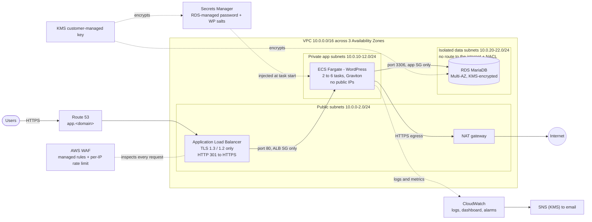

# Architecture

## Diagram

## Request path

1. Route 53 resolves `app.<domain>` to the ALB (alias record).
2. AWS WAF evaluates the request: Amazon IP reputation list, Core rule set,
   known bad inputs, SQL injection, WordPress-specific rules, and a per-IP rate limit.
3. The ALB terminates TLS with an ACM certificate (DNS-validated, auto-renewed),
   drops malformed headers and forwards to a healthy task in any AZ.
4. The task reaches the database over port 3306. Only the app security group is
   allowed in, and the data subnets' NACL only admits the app subnet CIDRs.
5. Outbound calls from tasks (image pulls, WordPress updates) leave through the
   NAT gateway; nothing on the internet can initiate a connection to a task.

## Tiers

| Tier | Subnets | Internet route | Who can reach it | Controls |
|------|---------|----------------|------------------|----------|
| Public | 3 x /24 | IGW (in and out) | Anyone on 80/443 | WAF, TLS policy, ALB SG egress only to app SG |
| App | 3 x /24 | NAT (out only) | ALB security group | No public IPs, app SG, secrets from Secrets Manager |
| Data | 3 x /24 | None | App security group | DB SG (no egress), NACL, KMS encryption, Multi-AZ |

## Resilience

| Failure | What happens |
|---------|--------------|
| A task crashes | ALB health check fails, ECS replaces the task; the other tasks keep serving |
| A bad deployment | Deployment circuit breaker detects failing tasks and rolls back automatically |
| Traffic spike | Target tracking on CPU (60%) and on requests per target scales tasks out within minutes |
| An AZ fails | Tasks run in all 3 AZs; RDS fails over to its synchronous standby (typically 1-2 minutes) |
| NAT AZ fails (single NAT mode) | Serving continues; only outbound calls from tasks are affected. Set `single_nat_gateway = false` to remove this dependency (see ADR 0002) |
| Region fails | Out of scope here - covered by the companion repo `aws-multi-region-dr` |

## Module map

| Module | Responsibility |
|--------|----------------|
| `modules/kms` | Customer-managed key + key policy for Logs, SNS, RDS, Secrets Manager |
| `modules/network` | VPC, 9 subnets, IGW, NAT, route tables, data NACL, S3 gateway endpoint, flow logs |
| `modules/security-groups` | All tier-to-tier rules in one reviewable file |
| `modules/edge` | ALB, target group, ACM, Route 53, WAF + logging, access-log bucket |
| `modules/database` | RDS MariaDB, parameter group, log exports, Enhanced Monitoring |
| `modules/app` | ECS cluster, task definition, service, IAM roles, salts secret, autoscaling |
| `modules/observability` | SNS topic, 8 alarms, CloudWatch dashboard |
